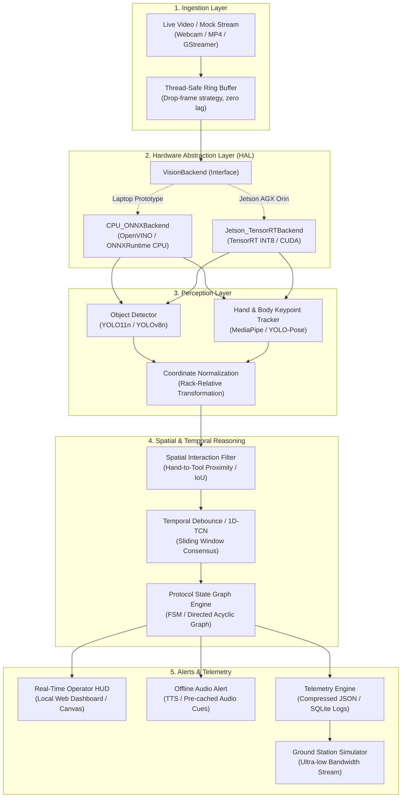
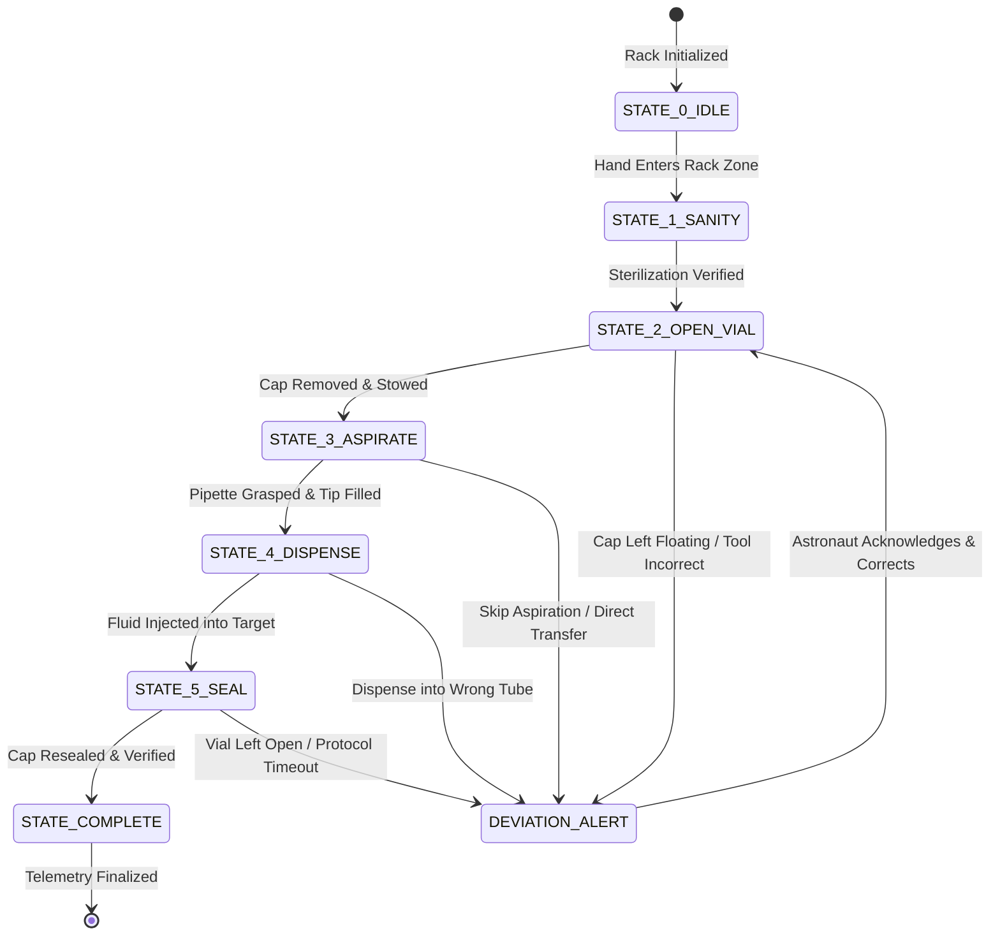

# SUTRA: Architecture Design Document
## CPU-First Prototype & Jetson AGX Orin Migration Architecture

- **Project:** SUTRA (Smart Unified Task & Recognition Assistant)
- **Problem Statement ID:** SIH26174 | **Theme:** Space Technology
- **Team ID:** 162833 | **Team Name:** Team Samay
- **Target Environments:**
  1. **Phase 1 (Active MVP):** 8 GB RAM Consumer Laptop (CPU-only, Windows/Linux)
  2. **Phase 2 (Flight Target):** NVIDIA Jetson AGX Orin (15W - 60W, 32/64 GB Unified Memory, Ampere GPU + Tensor Cores)

---

### 1. Architectural Philosophy: Why Object Detection Alone Fails

In space flight and safety-critical science payloads, **generic object detection is never proof of completed activity recognition**.

```
+-------------------------------------------------------------------------------------------------------+
|                                    THE DETECTION != ACTIVITY PITFALL                                   |
+-------------------------------------------------------------------------------------------------------+
| Scenario: "Step 3: Transfer 100 uL of Reagent into Sample Vial A"                                      |
|                                                                                                       |
| [Naive Detection System]:                                                                              |
|   1. Finds "pipette" (conf: 0.91)                                                                     |
|   2. Finds "vial" (conf: 0.88)                                                                        |
|   -> Concludes: "Step 3 is complete!"  <--- CATASTROPHIC FALSE POSITIVE                               |
|                                                                                                       |
| What actually happened:                                                                               |
|   - The astronaut was simply moving the pipette across the camera frame to place it in the cradle.    |
|   - No fluid was aspirated.                                                                           |
|   - No tip was attached.                                                                              |
|   - The vial cap was never removed.                                                                   |
|   - Result: Experiment fails, biological sample spoiled, days of mission time wasted.                |
|                                                                                                       |
| [SUTRA Multi-Stage Action Understanding]:                                                             |
|   1. Object & Keypoint Detection: Localizes pipette, tip box, vial, and hand joints.                 |
|   2. Hand-Object Interaction (HOI): Confirms <Right Hand, Grasps, Pipette> and <Pipette, Enters, Tip>.|
|   3. Temporal State Engine: Tracks phase duration (Hand at vial for delta t >= 3.0s with plunge action)|
|   4. Protocol DAG Validator: Verifies preceding step ("Vial Cap Removed") was satisfied first.        |
|   -> Concludes: "Step 3 verified only when full causal sequence and temporal dwell time complete."    |
+-------------------------------------------------------------------------------------------------------+
```

To prevent false completions, SUTRA enforces a **multi-stage verification pipeline**:
1. **Physical Preconditions:** Previous protocol states in the Directed Acyclic Graph (DAG) must be in status `COMPLETED`.
2. **Spatial Adjacency & Contact:** Hand keypoints must actively engage with the designated tool bounding box.
3. **Temporal Dwell & Motion Signature:** The interaction must persist over a realistic temporal duration ($\Delta t_{min} \le \Delta t \le \Delta t_{max}$), filtered through a sliding-window hysteresis debounce.
4. **Post-Condition Verification:** State transitions are verified by observing resulting environmental changes (e.g., container state changes from `SEALED` to `OPEN`).

---

### 2. High-Level System Architecture

The following diagram illustrates the modular architecture of SUTRA, highlighting the separation between the Hardware Abstraction Layer (HAL), the Perception Engine, the Temporal Protocol Reasoner, and the Output Handlers:



---

### 3. CPU-First Prototype Engineering (8 GB Laptop Target)

Running real-time computer vision and state estimation on a standard laptop with **8 GB RAM and no dedicated GPU** requires deliberate architectural discipline:

#### 3.1 Strict Memory Budget (< 2.0 GB RSS Target)
An 8 GB laptop running Windows typically has 4.0 to 5.0 GB consumed by the OS, background tasks, and browser/IDE instances. SUTRA must operate strictly within **1.2 GB to 1.8 GB RAM**:
- **Video Buffer:** 10-frame circular ring buffer in uncompressed BGR format ($720\text{p} = 1280 \times 720 \times 3 \approx 2.76\text{ MB/frame} \times 10 \approx 28\text{ MB}$).
- **ONNX Runtime Engine:** YOLO11n INT8/FP32 model weights and execution memory: $\approx 150\text{ MB}$.
- **MediaPipe Hands / Keypoint Estimator:** Lite model footprint: $\approx 120\text{ MB}$.
- **Protocol DAG & Temporal State:** In-memory state tracking: $\approx 15\text{ MB}$.
- **Application Core (FastAPI / PySide UI):** $\approx 100 - 150\text{ MB}$.
- **Total Estimated Memory:** $\mathbf{\approx 450 - 650\text{ MB}}$ base footprint, safely below the 2.0 GB threshold.

#### 3.2 Non-Blocking Ingestion & Frame-Drop Strategy
A common bug in OpenCV video loops is processing delay causing buffer bloat (where the displayed video lags real-world time by several seconds).
- **Architecture Solution:** A dedicated `FrameIngestor` thread continuously reads frames from the camera/file into a single-slot buffer (`cv2.VideoCapture.read()`).
- The `PerceptionWorker` thread grabs the most recent available frame (`buffer.get_latest()`).
- If inference takes 120 ms, the ingestor drops intermediate frames rather than queuing them. This guarantees that **system reaction latency is zero-lag relative to the physical clock**.

#### 3.3 Decoupled Inference Rates
- **Ingestion & UI Rendering:** 30 FPS for smooth visual playback.
- **Heavy Perception (YOLO + Pose):** Evaluated at 5 Hz to 10 Hz (every 3rd or 6th frame).
- **Temporal State Engine:** Evaluated at 10 Hz, retaining previous detections between frames using lightweight Euclidean centroid tracking (Kalman / SORT optional).

#### 3.4 Microgravity Coordinate Normalization
In microgravity, an astronaut may work sideways or upside down.
1. The camera observes the payload bay. Four fiducial anchors (or rack corners) define reference points $P_1, P_2, P_3, P_4$.
2. An affine/perspective transformation matrix $M_{norm}$ is computed:
   $$\begin{bmatrix} X_{rack} \\ Y_{rack} \\ 1 \end{bmatrix} = M_{norm} \begin{bmatrix} X_{pixel} \\ Y_{pixel} \\ 1 \end{bmatrix}$$
3. All hand positions, bounding box centroids, and interaction distances are computed in normalized rack space $[0.0, 1.0] \times [0.0, 1.0]$, making the system completely immune to body orientation shifts.

---

### 4. Protocol State Graph Engine (DAG)

The core logic is modeled as a Directed Acyclic Graph (DAG) with explicit transition conditions, timeout bounds, and error fallbacks:



#### Transition Evaluation Rules
1. **Debounce Filter (Hysteresis):** A transition candidate must be predicted across at least $K=5$ consecutive processed frames before state transition executes, eliminating single-frame visual flicker or transient occlusions.
2. **Deviation Detection:** If an action occurs that violates the DAG edge prerequisites (e.g., reaching for the target vial with an unprimed pipette), the engine transitions to `DEVIATION_ALERT` state, dispatches an audio chime + speech warning ("Step 3 skipped: Aspiration not detected"), and logs an anomaly event to telemetry.

---

### 5. Migration Strategy: From Laptop Prototype to Jetson AGX Orin

The codebase is engineered from Day 1 to support seamless migration to the NVIDIA Jetson AGX Orin platform through explicit abstraction layers:

| Component | Laptop Prototype (Phase 1) | NVIDIA Jetson AGX Orin (Phase 2 Target) | Migration Path / Code Impact |
| :--- | :--- | :--- | :--- |
| **Hardware Abstraction** | `CPU_ONNXBackend` | `Jetson_TensorRTBackend` | Implements identical `VisionBackend` abstract base class. Zero change to application or state machine logic. |
| **Inference Acceleration** | ONNX Runtime (CPU / OpenVINO Execution Provider, INT8/FP32). | NVIDIA TensorRT (Ampere GPU + DLA cores, FP16/INT8 with calibration cache). | Run `trtexec --onnx=model.onnx --saveEngine=model.engine --fp16` on Jetson; swap backend configuration string. |
| **Video Ingestion** | OpenCV `VideoCapture` (Standard UVC / MP4 decoding via CPU FFmpeg). | GStreamer with hardware acceleration (`nvv4l2camerasrc ! nvvidconv ! video/x-raw(memory:NVMM)`). | Write Jetson GStreamer pipeline string in ingestion factory. Zero CPU-to-GPU memory copies. |
| **Interaction Recognition** | Geometric Hand-Object Proximity (Euclidean distance + IoU heuristics). | Deep HO-RCNN / Interaction Transformer compiled to TensorRT. | Drop-in replacement module inside `Reasoning` package. |
| **Temporal Sequence Smoothing** | Sliding-window majority voting & state debounce filter. | 1D-TCN / Temporal Convolutional Network or Video-Swin Transformer. | TCN model outputs probability distribution directly feeding the DAG engine. |
| **Voice & Speech Feedback** | Lightweight offline TTS (pyttsx3 / pre-generated audio prompts). | Piper TTS (neural voice) + Whisper.cpp for offline voice query transcription. | Offload to Jetson CPU/GPU threads; interface remains standardized audio queue. |
| **Cognitive Assistant (RAG)** | Disabled or mock procedural rule-lookup. | Local Quantized Llama-3-8B GGUF via `llama.cpp` + FAISS vector database. | Separate background service communicating with SUTRA core via local REST/IPC API. |

> [!TIP]
> **Portability Guarantee:** All mathematical calculations, state transition definitions, telemetry schemas, and user interface communications are decoupled from deep learning inference runtimes. Switching between laptop CPU execution and Jetson AGX Orin requires changing only the configuration file and backend model loader.

